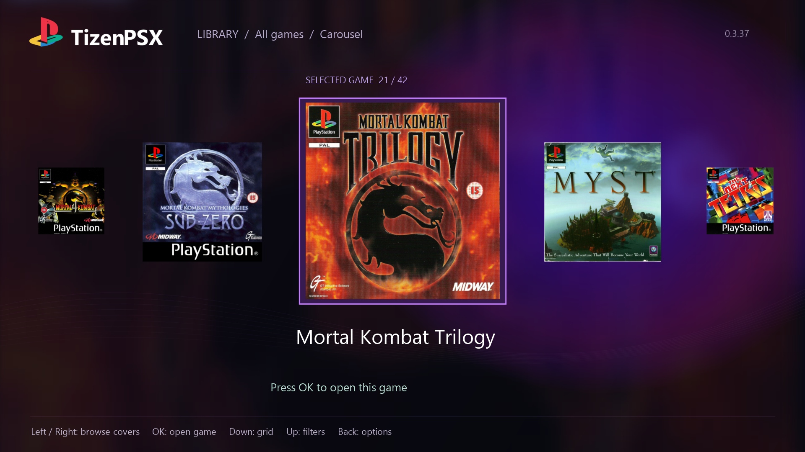

# TizenPSX

PlayStation 1 emulation for Samsung Tizen TVs, powered by PCSX ReARMed.

## Current look

*1920 × 1080 desktop render of the current native app layout, showing Mortal Kombat Trilogy. This is a UI preview, not a direct TV capture; font rendering and compositing may differ on the TV. November 2026.*

## Development status

The current build is working well and has been reported stable in ongoing TV testing. The library includes a cover carousel, grid view, favourites and per-game options. Compatibility with other TVs, controllers and games still needs wider testing.

Source code, installation instructions and release packages will be added when ready.

An independent community project; not affiliated with Samsung, Sony or the PCSX ReARMed team. Game artwork shown belongs to its respective owners; no games or BIOS files are provided here.
