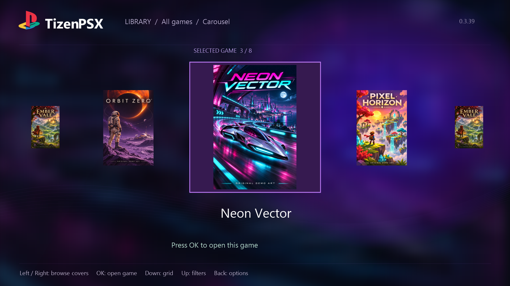
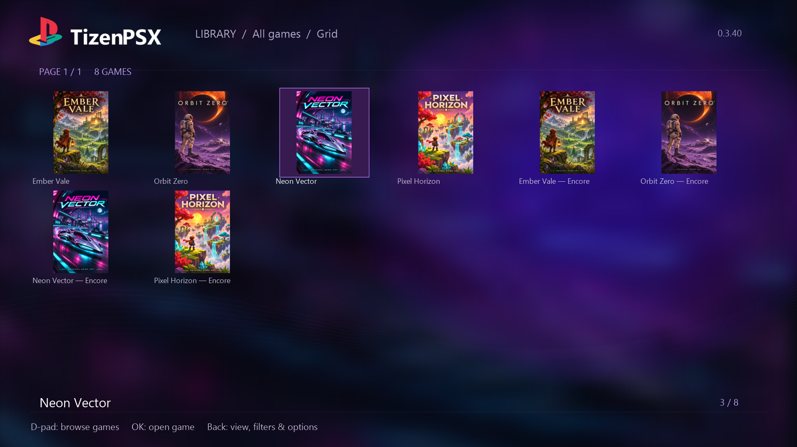

# TizenPSX 0.3.39

PlayStation emulation powered by PCSX ReARMed. Browse your PlayStation collection in a cover carousel or switch to a grid for a wider view.

*Current development interface, rendered from app layout code with sample artwork. This is a desktop preview, not a TV capture; your own games and covers populate the library. [Preview details](docs/showcase/README.md).*

[Download current source](https://github.com/DadeRushmore/TizenPSX/archive/refs/heads/main.zip) · [Releases](https://github.com/DadeRushmore/TizenPSX/releases) · [Build guide](BUILD.md)

## More views

**Grid view**

## Download and installation status

**Public source edition.** This repository builds on the curated development baseline frozen on 16 November 2026 and published on 22 November 2026. The main branch also includes the interface previews and documentation corrections shown here. The full source is browsable here: clone the repository or use **Code → Download ZIP**. There is no separate missing source download.

**This version does not include an installable TPK and is not an out-of-the-box build.** Native executables, private packages and selected prebuilt runtime assets are omitted. See [BUILD.md](BUILD.md) for the source layout and prerequisites, and [DISTRIBUTION.md](DISTRIBUTION.md) for the remaining binary-release work.

The earlier [0.3.38 beta installer](https://github.com/DadeRushmore/TizenPSX/releases/tag/v0.3.38-beta) remains available with its original source archive and limitations. This source update does not replace it with a 0.3.39 installer.

## Source layout

| Material | Location |
|---|---|
| TV application | `ports/TizenPS-0.3.34/roelofs-psx-native/` |
| Native integration/build tooling | `ports/TizenPS-0.3.34/pcsx-rearmed-native/tizen-build/` |
| Vendored emulator source | `ports/TizenPS-0.3.34/pcsx-rearmed-native/` |
| Exact file hashes | [SOURCE-MANIFEST.json](SOURCE-MANIFEST.json) |
| Exclusions and release metadata | [PUBLIC-SOURCE.json](PUBLIC-SOURCE.json) |

## Verification

With Python 3 installed, run `python tools/verify-public-source.py` from the repository root. This checks the file inventory, SHA-256 hashes, credential patterns and compiled executable signatures. It does not compile the emulator or establish TV compatibility. See [VALIDATION.md](VALIDATION.md).

## Licensing and artwork

Frontend/PCSX ReARMed GPL-2.0; glibc subset LGPL-2.1-or-later; Overscan MIT; vendored components retain their notices.

The top-level LICENSE covers the project code; third-party components retain their individual licenses. See [THIRD-PARTY-NOTICES.md](THIRD-PARTY-NOTICES.md). No commercial game files, retail BIOS images, private signing keys or device pairing files are supplied. The README previews use fictional demo covers; see [preview and artwork notes](docs/showcase/README.md). Application placeholder artwork is generated by [render-public-art.py](render-public-art.py); its inventory is [public-art.json](public-art.json). Vendored upstream source assets retain their own notices.

Independent community project; not affiliated with Samsung, Sony, Nintendo or the upstream emulator teams. No new TV gameplay or compatibility claim is made by this source publication.
